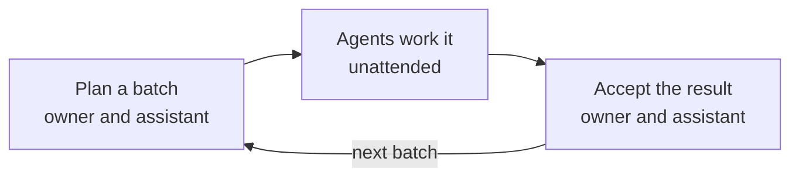
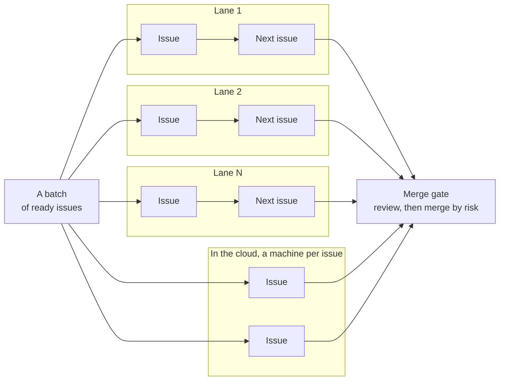
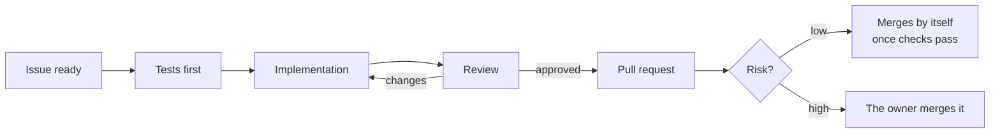

# agent-kit

AI agents build and test the software. A person, the owner, decides what gets built and approves what ships.

agent-kit is a plugin for Claude Code and the process behind it: the owner spends their attention on choosing the work and accepting the result, and the agents do everything in between, unattended.

## How it works

Work moves in batches. The owner and an assistant plan a batch together, the agents work through it while the owner is away, and then the two of them go over the result.

A batch's issues don't wait for one another. The batch splits them into lanes, Lane 1, Lane 2 … Lane N, and the lanes work side by side, each taking its issues in order. Some issues can also go to the cloud, where each one runs on a machine of its own and leaves the owner's computer free. So a batch of many issues takes about as long as its longest lane, not the sum of all of them. Whichever way an issue went, its work reaches the same merge gate.

Each issue in a batch follows the same path. Tests come first, a separate reviewer checks the change, and only the risky changes wait for the owner.

## What it does

- **Guardrails it enforces:** agents never push to the main branch, never read secrets or build anything outside an approved issue, and a batch's agents never merge. These are blocked by rules and code, not just asked for. In a session, an agent merges a pull request only when the owner asks for that one.
- **Quality it checks:** every criterion that can be automated has a test, written before the code. Formatting, linting, types, size and complexity limits, coverage and a dependency audit run on every change.
- **What waits for the person:** the questions only the owner can answer, the high-risk changes to merge, and the checks that need human eyes. Everything else keeps moving.

## Learn more

- [SPEC.md](SPEC.md): the whole process, and the source of truth.
- [docs/usage.md](docs/usage.md): requirements, install, the batch runner, and developing the kit.
